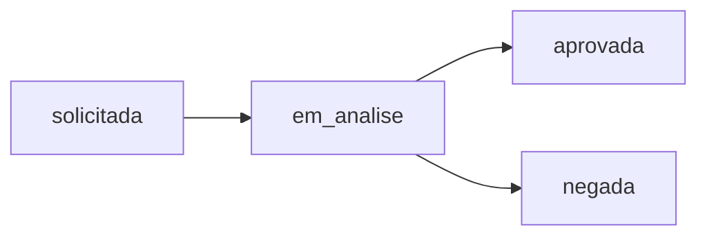

# 00 - Abertura

A **Vida+ Saúde** é uma operadora de plano de saúde (fictícia). Antes de fazer uma ressonância, uma cirurgia ou uma internação, o prestador (hospital, clínica, médico) pede uma **autorização prévia**, a "guia". O atendente da operadora passa o dia respondendo a mesma pergunta, por telefone: *"qual o status da guia AUT-00058?"*. E, entre uma ligação e outra, as dúvidas de regra: *"qual o prazo para autorizar uma ressonância?"*.

Hoje você constrói, do zero ao app, o que esse atendente usa: os eventos de autorização chegam crus, o pipeline limpa e consolida, o Postgres serve o app, e um agente responde as dúvidas.

## Objetivo
- Conhecer o cenário e os dados do dia
- Ver a arquitetura que você vai montar, módulo a módulo
- Ver os primeiros eventos chegarem

## Os dados

Cada mudança de status de uma guia é um **evento de autorização**:

```json
{"autorizacao_id": "AUT-00826", "beneficiario_id": "BEN-0212", "prestador_id": "PRE-034", "procedimento": "tomografia", "event_id": "AUT-00826-1", "status": "solicitada", "event_ts": "2025-12-06T00:06:00"}
```

Uma guia passa por vários eventos ao longo da vida:



O que o atendente precisa é do **status atual**: o último evento de cada guia. Parece simples, mas os eventos chegam como num sistema real:

- **um lote a cada 10 min**, o dia inteiro (42 lotes, ~5.400 eventos, ~2.000 guias). As respostas mudam ao longo do dia;
- **com duplicatas**: o mesmo evento chega duas vezes;
- **fora de ordem**: um evento atrasado chega depois de outro mais novo da mesma guia;
- **com alguns inválidos**: sem `autorizacao_id`, ou com um status que não existe.

Quem escreve os lotes é o **gerador**, um job do instrutor, em `/Volumes/academydb/shared/raw/autorizacao_eventos/`. Ao lado, em `raw/docs/`, estão os 9 PDFs da operadora (rol de cobertura, regras de autorização, prazos, FAQ do prestador...), que o agente usa no módulo 3.

## O que você vai construir

A arquitetura completa está no [Início](../README.md#arquitetura). Módulo a módulo:

| Módulo | O que sobe no seu schema |
|---|---|
| 01 - Pipeline e bundle | Pipeline (bronze → silver → gold) e job, primeiro em `dev`, depois em `prod` |
| 02 - Lakebase | Synced table no Postgres e a tabela de observações |
| 03 - Agente | Trechos dos PDFs, índice de AI Search, model service, Genie space e o app do agente |
| 04 - App | O app do atendente |

Tudo, menos o agente e o Genie space, fica declarado num **bundle**: um `databricks.yml` que começa com 3 recursos no módulo 1 e cresce até o módulo 4.

## Passo 1: O líder liga o gerador
O instrutor (ou o líder, o admin do workspace) abre o job `edia_gerador_eventos` e:

1. clica em **Run now**: o lote 1 chega na hora;
2. clica em **Resume** no schedule: um lote a cada 10 min. Depois do 42º, o job se pausa sozinho.

Se o dia encurtar, os últimos lotes não chegam, sem quebrar nada: nenhum passo do workshop depende de todos os lotes terem chegado. Detalhes em [00 - Preparação](../00%20-%20Prepara%C3%A7%C3%A3o/README.md#na-abertura-do-workshop).

## Passo 2: Ver o primeiro lote
No menu lateral, **Catalog** → `academydb` → `shared` → **Volumes** → `raw` → `autorizacao_eventos`. O arquivo `lote_001.json` tem um evento por linha. Abra e procure uma duplicata ou um status estranho.

## Passo 3: Escolher o seu nome de aluno
Primeira letra do nome + sobrenome, sem acento e em minúsculas (ex.: Augusto Carneiro → `acarneiro`). Ele vira o nome do seu schema (`academydb.acarneiro`) e aparece no nome de tudo o que você cria. Se alguém da turma já tiver o mesmo, acrescente um número (`acarneiro2`).

---

## Como os módulos funcionam
- **Passos**: o roteiro, na ordem. Quase tudo é feito pela interface do Databricks.
- **TODO**: 1 ou 2 por módulo. O README diz o que fazer, onde, e como saber que deu certo. A resposta fica num bloco **👉 Solução**, logo abaixo: tente antes de abrir.
- **Checkpoint**: uma célula de notebook com `assert` que confirma o estado esperado (✅ quando passa).
- **🎯 Desafio**: opcional, para quem terminar antes.
- **`dev` e `prod`**: no módulo 1, você testa em `dev` e promove para `prod`. Daqui em diante, o dia segue em `prod`, para ganhar tempo.

Pronto? Siga para **[01 - Pipeline e bundle](../01%20-%20Pipeline%20e%20bundle/README.md)**.
