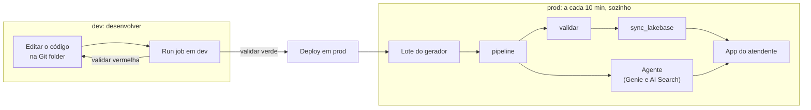

# 05 - Fechamento

De manhã, um evento de autorização era uma linha de JSON num Volume, com duplicatas, fora de ordem e às vezes inválido. Agora ele passa por um pipeline que limpa e consolida, chega ao Postgres em minutos e aparece na tela do atendente, que pode anotar o que o prestador disse e perguntar ao agente tanto a regra quanto o número.

## O que você construiu

| Módulo | Entrega | A ideia |
|---|---|---|
| 01 - Pipeline e bundle | Pipeline bronze → silver → gold e job, em `dev` e em `prod` | Você descreve **o que** cada tabela é; o pipeline cuida do **como**. `AUTO CDC` transforma eventos em status atual. |
| 02 - Lakebase | Synced table no Postgres e a tabela de observações | O lakehouse continua a fonte da verdade, e o Postgres serve o app em milissegundos. |
| 03 - Agente | Trechos dos PDFs, índice de AI Search, model service, Genie space e o app do agente | RAG para o que está nos documentos, Genie para o que está nas tabelas. |
| 04 - App | O app do atendente | O SP do app faz o que vale para todos; o token de quem está logado, o que depende de quem pergunta. |

## A solução inteira em código

Quase tudo o que você subiu hoje está em três arquivos de configuração, mais o código:

| Arquivo | O que declara | Como sobe |
|---|---|---|
| `01 - Pipeline e bundle/databricks.yml` (+ `resources/`) | O que existe: schema, pipeline, job, synced table, model service, índice, app, e as permissões do SP do agente | **Deploy** do bundle |
| `03 - Agente/agente/agent.toml` | O agente: lojas de sessões e de memória, experimento de tracing e a tool da Genie | `agentbricks deploy` |
| `01 - Pipeline e bundle/src/app/app.yaml` | Como o app inicia e de quais recursos do bundle vêm as variáveis (`valueFrom`) | **Deploy** na página do app |

O bundle, no fim do dia:

```
01 - Pipeline e bundle/
├── databricks.yml                             # variáveis (aluno, agent_sp) e targets dev/prod
├── resources/
│   ├── aluno.schema.yml                       # módulo 1; grants ao SP do agente no módulo 3
│   ├── autorizacoes.pipeline.yml              # módulo 1
│   ├── autorizacoes.job.yml                   # módulo 1; task sync_lakebase no módulo 2
│   ├── autorizacao_status.synced_table.yml    # módulo 2
│   ├── llm.model_service.yml                  # módulo 3
│   ├── documentos.index.yml                   # módulo 3
│   └── app.app.yml                            # módulo 4
└── src/
    ├── pipeline/                              # bronze.py, silver.py, gold.py, notificacoes.py; documentos.sql no módulo 3
    ├── validar.py
    └── app/                                   # o app do atendente, com o app.yaml
```

<details markdown="1">
<summary>👉 O <code>databricks.yml</code> final</summary>

```yaml
# Bundle do workshop: tudo o que você sobe no Databricks, declarado em código.
# Ele cresce ao longo do dia: o módulo 1 traz o schema, o pipeline e o job.
bundle:
  name: vida_saude

include:
  - resources/*.yml

variables:
  aluno:
    description: Seu nome de aluno (primeira letra do nome + sobrenome, por exemplo acarneiro). Vira o nome do seu schema.
    default: acarneiro
  catalog:
    description: Catálogo do workshop. Não mude.
    default: academydb
  eventos_path:
    description: Pasta onde o gerador escreve os lotes de eventos. Não mude.
    default: /Volumes/academydb/shared/raw/autorizacao_eventos
  agent_sp:
    description: Application ID do service principal do app do seu agente (agent-bricks-<aluno>).
    default: 00000000-0000-0000-0000-000000000000 # o ID que a seção 3 do módulo 3 mostrou

targets:
  # dev: prefixa o schema com dev_<usuario>_, os jobs e pipelines com [dev <usuario>] e pausa os schedules.
  dev:
    mode: development
    default: true

  # prod: nomes sem prefixo e schedules ligados.
  prod:
    mode: production
    workspace:
      root_path: /Workspace/Users/${workspace.current_user.userName}/.bundle/${bundle.name}/${bundle.target}
```

O `include: resources/*.yml` é o que fez cada arquivo novo dos módulos 2–4 entrar no bundle sem você mexer aqui.

</details>

<details markdown="1">
<summary>👉 O <code>agent.toml</code> e o <code>app.yaml</code></summary>

`03 - Agente/agente/agent.toml`, depois do `sed` e do `agentbricks tools add` do módulo 3:

```toml
schema_version = 1

[agent]
framework = "langgraph"
server = "agentbricks"

[memory_store]
name = "edia-acarneiro-memoria"

[session_store]
name = "edia-acarneiro-sessoes"

[tracing]
experiment_name = "/Shared/agentbricks_traces/edia-acarneiro"

[[tools]]
id = "genie_agent"
auth = "user"
source = {kind = "genie_agent", space_id = "<id do Genie space>"}
```

`01 - Pipeline e bundle/src/app/app.yaml`:

```yaml
command: [npm, run, start]
env:
  - name: LAKEBASE_ENDPOINT
    valueFrom: postgres
  - name: AGENT_APP
    valueFrom: agente
```

`postgres` e `agente` são os nomes dos recursos que o `app.app.yml` do bundle declara. O bundle diz **o que** o app pode acessar; o `app.yaml`, **como** o código recebe esses valores.

</details>

Fica fora dos arquivos, feito à mão: o Genie space (pela UI) e, no Postgres, a `observacao_atendente` e os 3 GRANTs ao SP do app (pelos notebooks dos módulos 2 e 4).

## O ciclo



Em `dev`, o código é lido direto da Git folder, e você repete o ciclo até a `validar` ficar verde. Em `prod`, o deploy copia o código, e o schedule faz o resto: a cada lote, o pipeline atualiza as tabelas, a `validar` barra dados errados antes que cheguem ao Postgres, e o app e o agente acompanham.

## Para onde ir depois

### Lakebase Change Data Feed: o caminho de volta
Hoje, os dados vão do lakehouse para o Postgres. As observações que os atendentes gravam ficam só no Postgres: nenhum dashboard nem a Genie enxergam. O **Lakebase Change Data Feed** (Public Preview, antes chamado Lakehouse Sync) faz o caminho de volta: copia cada insert, update e delete de um schema do Postgres para tabelas Delta no Unity Catalog (`lb_<tabela>_history`), a cada ~15 s.

Com ele, a `observacao_atendente` vira `lb_observacao_atendente_history`, pode entrar no pipeline como mais uma bronze, e a Genie, com essa tabela no space, responderia "quais prestadores mais pedem prioridade?". Para ligar, o admin habilita o preview, as tabelas precisam de `REPLICA IDENTITY FULL`, e quem configura precisa de `CAN MANAGE` no projeto Lakebase (por isso ficou fora do hands-on).

### O que ficou só no guia
- **CLI de bundles, `run_as` e CI/CD**: no módulo 1, seção **O mesmo pelo CLI, e num CI**.
- **Synced table Continuous**: no módulo 2, seção **Triggered, Continuous ou Snapshot**.
- **Structured Streaming "na mão"**: os comentários abaixo de cada bloco do pipeline, e a seção **Por que SDP é o padrão** do módulo 1.
- **Escrever o agente**: o projeto do módulo 3 nasceu de `agentbricks init --framework langgraph`. Para outro caso de uso, o caminho é o mesmo: trocar o prompt e as tools em `agent/agent.py` e `agent.toml`.
- **Mudar o app**: o código está em `01 - Pipeline e bundle/src/app/` (`server/` em Node.js, `client/` em React). Edite, faça **Deploy** no bundle e **Deploy** na página do app (ou `databricks bundle run -t prod vida_saude`, que sobe o código pelo CLI).

---

Obrigado por participar, e bons projetos! 👏
