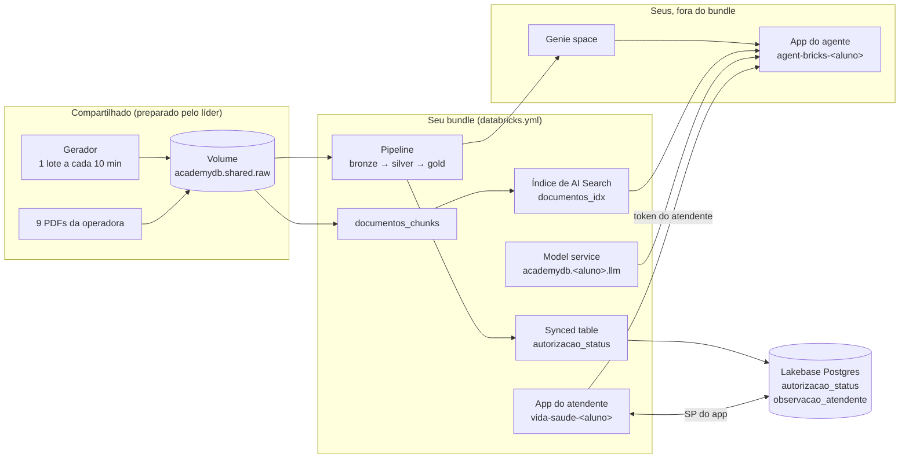

# Engenharia de Dados e IA no Databricks

Workshop hands-on de 1 dia (~7h30), com instrutor, que leva um **evento de autorização** da Vida+ Saúde, uma operadora de plano de saúde fictícia, do arquivo cru até a tela do atendente. No caminho, você declara tudo num **bundle**: um pipeline que limpa e consolida os eventos, uma cópia em Postgres para o app, um agente que responde perguntas sobre regras e números, e o app que junta tudo.

## Objetivo

Ao fim do dia, você terá construído e publicado, no seu próprio schema:
- um pipeline declarativo (Lakeflow Spark Declarative Pipelines) com Auto Loader, expectations e `AUTO CDC`, orquestrado por um job, com deploy em `dev` e promoção para `prod`;
- uma synced table no **Lakebase**, o Postgres gerenciado do Databricks, que acompanha o pipeline a cada lote;
- um **agente** que busca nos documentos da operadora (AI Search) e consulta as suas tabelas (Genie);
- o **app do atendente**, que consulta guias, grava observações e conversa com o agente.

Não precisa de experiência com Spark nem com Databricks. Os dados são sintéticos e chegam ao longo do dia, um lote a cada 10 min, com duplicatas, atrasos e alguns eventos inválidos, como num sistema real.

## Arquitetura



- **Recursos compartilhados** (criados uma vez pelo líder): o catálogo `academydb`, o Volume com os eventos e os PDFs, o gerador, o projeto Lakebase `edia-workshop` e os endpoints de AI Search.
- **Recursos do aluno** (criados pelo seu bundle): o schema `academydb.<aluno>`, com tudo o que você constrói, e o app do atendente. O agente e o Genie space também são seus, mas ficam fora do bundle.

## Trilha

| Módulo | Tempo | Conteúdo |
|---|---|---|
| **[00 - Abertura](00%20-%20Abertura/README.md)** | 15 min | O cenário da Vida+ Saúde, a arquitetura do dia e o gerador de eventos ligado. |
| **[01 - Pipeline e bundle](01%20-%20Pipeline%20e%20bundle/README.md)** | 150 min | Um bundle pronto com schema, pipeline e job. Deploy em `dev`, a falha sem `AUTO CDC`, a correção e a promoção para `prod`. |
| **[02 - Lakebase](02%20-%20Lakebase/README.md)** | 40 min | A silver vira uma synced table no Postgres, sincronizada a cada run do job, e a tabela de observações que o app grava. |
| **[03 - Agente](03%20-%20Agente/README.md)** | 50 min | Trechos dos PDFs no pipeline, índice de AI Search, model service e Genie space no bundle, e o agente publicado pelo web terminal. |
| **[04 - App](04%20-%20App/README.md)** | 45 min | O app do atendente declarado no bundle: status das guias, observações no Postgres e chat com o agente. |
| **[05 - Fechamento](05%20-%20Fechamento/README.md)** | 10 min | A solução inteira em código, o ciclo de ponta a ponta e para onde ir depois. |

Cada módulo tem um README com o roteiro e 1–2 **TODOs**, cada um com a solução num bloco **👉 Solução**. Os 🎯 **Desafios** são opcionais.

## Como começar

O repositório é `https://github.com/cwrneiro/Databricks-Master-Training-Advanced`. Os alunos o clonam como Git folder no módulo 1.

- **Aluno:** abra **[00 - Abertura](00%20-%20Abertura/README.md)**.
- **Líder** (o admin do workspace): antes do workshop, siga **[00 - Preparação](00%20-%20Prepara%C3%A7%C3%A3o/README.md)**.

## Site

Este repositório também é um site MkDocs, publicado em https://cwrneiro.github.io/Databricks-Master-Training-Advanced/ a cada push no `main`. Para ver localmente:

```bash
pip install -r requirements-docs.txt
mkdocs serve
```
