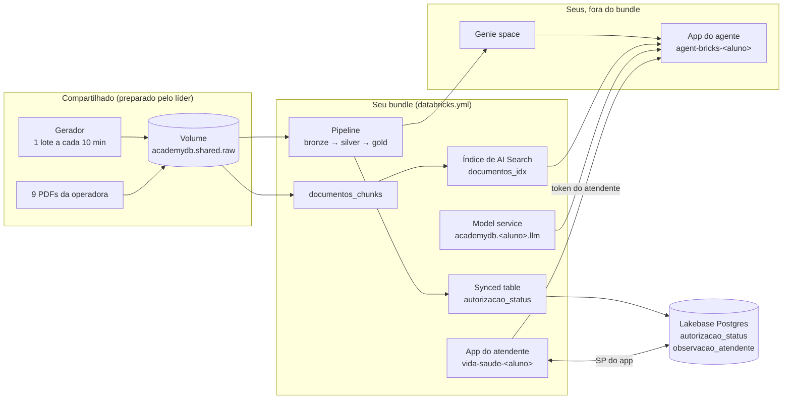
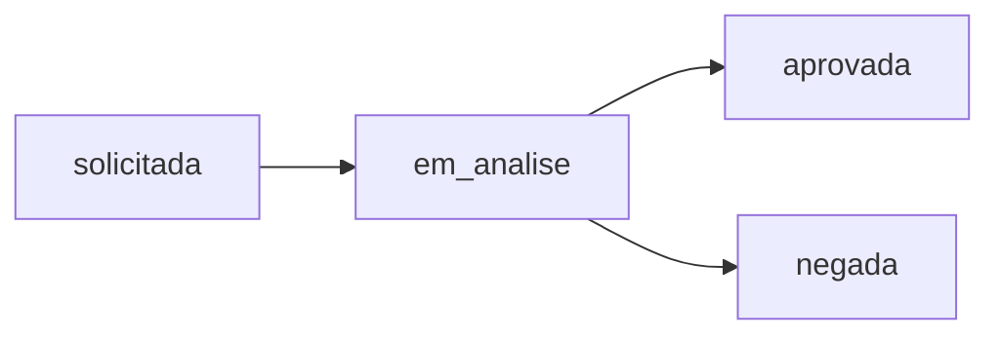

# Engenharia de Dados e IA no Databricks

Workshop hands-on de 1 dia (~7h30), com instrutor, sobre a Vida+ Saúde, uma operadora de plano de saúde fictícia.

Antes de uma ressonância, uma cirurgia ou uma internação, o prestador (hospital, clínica, médico) pede uma **autorização prévia**, a "guia". O atendente da operadora passa o dia respondendo a mesma pergunta, por telefone: *"qual o status da guia AUT-00058?"*. E, entre uma ligação e outra, as dúvidas de regra: *"qual o prazo para autorizar uma ressonância?"*.

Ao longo do dia, vamos construir o que esse atendente precisa: do arquivo cru de eventos até a tela dele, tudo declarado em código num **bundle**.

## Objetivo

Ao fim do dia, você terá publicado, no seu próprio schema:

- um **pipeline** declarativo com Auto Loader, expectations e `AUTO CDC`, orquestrado por um job, com deploy em `dev` e promoção para `prod`;
- uma cópia da tabela de status no **Lakebase**, o Postgres gerenciado do Databricks;
- um **agente** que busca nos documentos da operadora (AI Search) e consulta as suas tabelas (Genie);
- o **app do atendente**, que consulta guias, grava observações e conversa com o agente.

Não precisa de experiência com Spark nem com Databricks.

## Arquitetura



- **Compartilhado** (criado uma vez pelo líder): o catálogo `academydb`, o Volume com os eventos e os PDFs, o gerador, o projeto Lakebase `edia-workshop` e os endpoints de AI Search.
- **Seu**: o schema `academydb.<aluno>` e o app do atendente, criados pelo seu bundle. O agente e o Genie space também são seus, mas ficam fora do bundle.

## Os dados

Cada mudança de status de uma guia é um **evento de autorização**:

```json
{"autorizacao_id": "AUT-00826", "beneficiario_id": "BEN-0212", "prestador_id": "PRE-034", "procedimento": "tomografia", "event_id": "AUT-00826-1", "status": "solicitada", "event_ts": "2025-12-06T00:06:00"}
```

Uma guia passa por vários eventos:



O atendente só quer o **status atual**, o último evento de cada guia. Parece simples, mas os eventos chegam como num sistema real:

- **um lote a cada 10 min**, o dia inteiro (~5.400 eventos, ~2.000 guias). As respostas mudam ao longo do dia;
- **com duplicatas**: o mesmo evento chega duas vezes;
- **fora de ordem**: um evento atrasado chega depois de outro mais novo da mesma guia;
- **com alguns inválidos**: sem `autorizacao_id`, ou com um status que não existe.

Os lotes caem em `/Volumes/academydb/shared/raw/autorizacao_eventos/`. Ao lado, em `raw/docs/`, ficam os 9 PDFs da operadora (rol de cobertura, regras de autorização, prazos...), que o agente usa no módulo 3.

## Trilha

| Módulo | Tempo | Conteúdo |
|---|---|---|
| **[00 - Setup and teardown](00%20-%20Setup%20and%20teardown/README.md)** | Líder | Antes do workshop, prepara o ambiente compartilhado. Depois, o teardown. |
| **[01 - Pipeline e bundle](01%20-%20Pipeline%20e%20bundle/README.md)** | 165 min | Um bundle pronto com schema, pipeline e job: deploy em `dev`, a falha, a correção com `AUTO CDC` e a promoção para `prod`. |
| **[02 - Lakebase](02%20-%20Lakebase/README.md)** | 40 min | A silver vira uma synced table no Postgres, e você cria a tabela de observações do app. |
| **[03 - Agente](03%20-%20Agente/README.md)** | 50 min | Índice de AI Search sobre os PDFs, model service, Genie space e o agente publicado. |
| **[04 - App](04%20-%20App/README.md)** | 45 min | O app do atendente no bundle: status das guias, observações e chat com o agente. |
| **[05 - Fechamento](05%20-%20Fechamento/README.md)** | 10 min | A solução inteira em código e para onde ir depois. |

### Como os módulos funcionam
- **Passos**: cada módulo se divide em partes (1.1, 1.2...), e os passos seguem uma numeração só ao longo do módulo. Quase tudo é feito pela interface do Databricks.
- **🎯 Desafio**: opcional, para quem terminar antes. A solução fica fechada num bloco 👉: tente antes de abrir.
- **`dev` e `prod`**: no módulo 1, você testa em `dev` e promove para `prod`. Daqui em diante, o dia segue em `prod`, para ganhar tempo.

## Como começar

- **Aluno:** abra o **[01 - Pipeline e bundle](01%20-%20Pipeline%20e%20bundle/README.md)**.
- **Líder** (o admin do workspace): antes do workshop, siga o **[00 - Setup and teardown](00%20-%20Setup%20and%20teardown/README.md)**.
